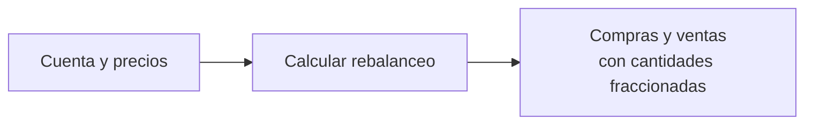

<div class="eyebrow">FRACCIÓN / KATA ZERO</div>

# Introducción a JUnit<br>con Kata Zero

<p class="lead">Un programa que parecía funcionar.<br>Un requisito nuevo. Una falla que pudimos detectar antes.</p>

<div class="cover-meta">
<span class="chip">Java 25 · Zulu</span>
<span class="chip">JUnit 6.1.3</span>
<span class="chip">Maven</span>
<span class="chip">Introducción · 7–8 minutos</span>
</div>

<!--
Entrada,15s: presentar la historia de un cambio pequeño que dejó un defecto. Cuenta y precios son ficticios.
Transición: primero mostrar el programa antes del requisito nuevo, sin explicar todavía JUnit.
-->

---

<div class="eyebrow">01 / EL PROGRAMA ORIGINAL</div>

# Al principio, solo manejábamos acciones completas

<div class="split equal">
<div>
<p class="lead">10 META y 10 AAPL.<br>Ambas a <strong>100 USD</strong>.<br>Objetivo: <strong>40% / 60% del valor</strong>.</p>
<div class="card" style="margin-top:24px"><h3>El menú propone operaciones</h3><p>Ver cuenta · Calcular rebalanceo · Salir.</p></div>
</div>
<div class="receipt">
<div class="eyebrow">CUENTA DE 2000 USD</div>
<div class="receipt-row"><span>Objetivo META</span><b>800 USD → 8 acciones</b></div>
<div class="receipt-row"><span>Objetivo AAPL</span><b>1200 USD → 12 acciones</b></div>
<div class="receipt-row total"><span>Plan</span><b>Vender 2 META</b></div>
<div class="receipt-row"><span></span><b>Comprar 2 AAPL</b></div>
</div>
</div>

<!--
Entrada,35s: explicar rebalancear como ajustar el valor repartido entre instrumentos. No enseñar teoría financiera.
Transición: el programa funciona para este caso de acciones completas, pero el requisito cambia.
-->

---
transition: fade
---

<div class="eyebrow">02 / LLEGA UN REQUISITO NUEVO</div>

# Ahora también queremos comprar y vender fracciones

<p class="lead">La cantidad ya no tiene que ser 2, 5 o 10.<br>También puede ser <strong>3.333333 acciones</strong>.</p>

<div class="diagram" style="margin-top:30px">



</div>
<div class="card purple" style="margin-top:26px" v-click><h3>«Entonces cambio int por double»</h3><p>Una adaptación que parece pequeña. ¿Será suficiente?</p></div>

<!--
Entrada,30s: introducir el requisito sin hablar de precisión financiera avanzada.
Clic: representar el razonamiento de quien adapta el programa. Transición: mostrar exactamente ese cambio.
-->

---

<div class="eyebrow">03 / LA ADAPTACIÓN RÁPIDA</div>

# Cambiamos el tipo de la cantidad

<div class="split code-compact">
<div>

````md magic-move {duration:600, lines:true}
```java
int targetValue = totalValue * targetPercent / 100;
int targetShares = targetValue / price;
int difference = targetShares - currentQuantity;
```
```java
int targetValue = totalValue * targetPercent / 100;
double targetShares = targetValue / price;
double difference = targetShares - currentQuantity;
```
````

</div>
<div class="stack">
<div class="card"><h3>Antes</h3><p>Cantidades completas en variables int.</p></div>
<div class="card purple"><h3>Después</h3><p>Las variables que guardan cantidades ahora aceptan decimales.</p></div>
</div>
</div>
<p class="caption">Fragmento del cálculo: por ahora conservamos los importes y precios enteros del ejemplo.</p>

<!--
Entrada,35s: un clic transforma int en double. No señalar todavía el tipo de los operandos de la división.
Transición: hacemos lo habitual: volver a ejecutar con los mismos datos y comparar a mano.
-->

---

<div class="eyebrow">VOLVEMOS A PROBAR A MANO</div>

# El ejemplo de siempre sigue funcionando


<div class="split equal" style="margin-top:22px">
<div class="card success"><h3>Vender 2 · Comprar 2</h3><p>Coincide con lo que ya esperábamos.</p></div>
<div class="card" v-click><h3>«Listo, ya acepta fracciones»</h3><p>Pero todavía no probamos un resultado fraccionario.</p></div>
</div>

<!--
Entrada,30s: captura de una ejecución real del programa adaptado. No simular una terminal con texto inventado.
Clic: mostrar el salto de confianza. Transición: cambiar un precio, manteniendo la misma cuenta.
-->

---

<div class="eyebrow">04 / OTROS DATOS</div>

# Solo cambia META: de 100 a 150 USD

<div class="trio">
<div class="card" v-click><div class="label">TOTAL DE LA CUENTA</div><h2>2500 USD</h2><p>10 × 150 + 10 × 100.</p></div>
<div class="card purple" v-click><div class="label">OBJETIVO META · 40%</div><h2>1000 USD</h2><p>1000 ÷ 150 = 6.666666… acciones.</p></div>
<div class="card success" v-click><div class="label">VENTA ESPERADA</div><h2>3.333333</h2><p>Tenemos 10; necesitamos conservar 6.666666…</p></div>
</div>
<p class="lead" style="margin-top:30px">Ese es el resultado esperado. <strong>Lo calculamos antes de ejecutar.</strong></p>

<!--
Entrada,45s: una operación por clic y tiempo para seguirla. Se proporciona el esperado, no se pide resolver un acertijo.
Transición: ejecutar el programa adaptado con estos datos nuevos.
-->

---

<div class="eyebrow">EL RESULTADO YA NO COINCIDE</div>

# Esperábamos vender 3.333333. Propone vender 4.


<div class="card warning" style="margin-top:24px" v-click><h3>El programa ejecuta, pero no cumple el requisito nuevo</h3><p>Ahora tenemos que volver a revisar y repetir la comparación cada vez que cambiemos el código.</p></div>

<!--
Entrada,35s: comparar explícitamente el esperado con la salida real. No llamar redondeo correcto a la pérdida de la fracción.
Transición: ¿y si esa comparación quedara escrita y se pudiera ejecutar automáticamente?
-->

---

<div class="eyebrow">05 / INTRODUCIMOS PRUEBAS UNITARIAS</div>

# Podemos guardar las expectativas en código

<p class="small">Dos pruebas guardan el ejemplo habitual: vender 2 META y comprar 2 AAPL.</p>

<div class="card warning" style="margin-top:22px" v-click><h3>Dos pruebas verdes todavía pueden omitir el defecto</h3><p>Repetir automáticamente el mismo caso entero no comprueba que funcionen las fracciones.</p></div>

<!--
Entrada,45s: mostrar el resultado real de dos pruebas. Explicar que una suite necesita ejemplos adecuados: JUnit no descubre requisitos por sí solo.
Clic: hacer explícito por qué verde no equivale a corrección universal. Transición: agregar el caso que faltaba.
-->

---

<div class="eyebrow">06 / LA PRUEBA QUE FALTABA</div>

# Escribimos la expectativa del caso fraccionario

<div class="code-compact">

```java {1|3|4|*}{lines:true}
@Test
void sellsFractionalSharesWhenPriceChanges() {
    double order = RebalanceCalculator.quantityToTrade(2500, 40, 150, 10);
    assertEquals(-3.333333, order, 0.000001);
}
```

</div>

<p class="caption">Primero lo esperado; después lo obtenido. La tolerancia permite comparar este resultado aproximado.</p>

<!--
Entrada,55s: los focos señalan la llamada con datos nuevos y luego el esperado con tolerancia. No enseñar todavía toda la API de assertions.
Mostrar la captura real: las pruebas anteriores pasan y la nueva revela el defecto. Transición: explicar qué quedó del supuesto de enteros.
-->

---

<div class="eyebrow">AHORA PODEMOS COMPROBAR LA CORRECCIÓN</div>

# Guardar en double no cambia una división entre int

<div class="split code-compact">
<div>

````md magic-move {duration:650, lines:true}
```java
int targetValue = totalValue * targetPercent / 100;
double targetShares = targetValue / price;
return targetShares - currentQuantity;
```
```java
int targetValue = totalValue * targetPercent / 100;
double targetShares = targetValue / (double) price;
return targetShares - currentQuantity;
```
````

</div>
<div class="stack">
<div class="card warning"><h3>1000 / 150</h3><p>Ambos operandos son int: primero se obtiene 6; después se guarda 6.0.</p></div>
<div class="card success"><h3>1000 / 150.0</h3><p>La división conserva una aproximación de la parte fraccionaria.</p></div>
</div>
</div>
<p class="caption">Usamos un ejemplo numérico pequeño para introducir pruebas. La representación decimal del dinero se abordará después.</p>

<!--
Entrada,45s: explicar el orden: primero se calcula la expresión, después se asigna. Un clic transforma solo la división.
La prueba se mantiene igual. Transición: volver a ejecutar toda la suite, no solo el caso nuevo.
-->

---

<div class="eyebrow">VOLVEMOS A EJECUTAR LA SUITE</div>

# Las anteriores siguen pasando. La nueva también.


<div class="split equal" style="margin-top:22px">
<div class="card success"><h3>Una comprobación reutilizable</h3><p>Ahora el caso fraccionario forma parte de nuestra red de pruebas.</p></div>
<div class="card" v-click><h3>Detectarlo antes</h3><p>Incluir ese caso al adaptar el programa habría señalado el defecto antes de dar el cambio por terminado.</p></div>
</div>

<!--
Entrada,35s: captura real de tres pruebas verdes. No afirmar que la suite valida todos los posibles resultados.
Clic: conectar el beneficio con la historia inicial. Transición: anunciar lo que se aprenderá durante el curso.
-->

---
class: chapter
transition: fade
---

<div class="eyebrow">07 / LO QUE APRENDEREMOS EN EL CURSO</div>

# Pruebas que explican.<br>Cambios con confianza.

<div style="margin-top:22px">
<span class="chip" v-click>JUnit y componentes de una prueba</span>
<span class="chip" v-click>AAA, ciclo de vida y excepciones</span>
<span class="chip" v-click>Pruebas parametrizadas</span>
<span class="chip" v-click>Mockito y aislamiento</span>
<span class="chip" v-click>TDD y refactorización</span>
<span class="chip" v-click>Tiempo, precisión y cobertura</span>
</div>
<p class="lead" style="margin-top:26px">Seguiremos con ejemplos del simulador Fracción.<br>Videos y práctica opcional, sin actividades calificadas.</p>

<!--
Entrada,30s: anunciar los temas del curso sin explicar sus técnicas todavía. Los nombres son una ruta, no prerrequisitos.
Salida: esta introducción motiva el curso; los detalles y la metodología se trabajan en las siguientes lecciones.
-->
