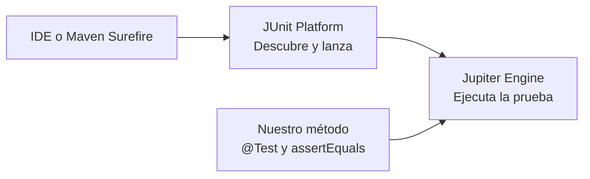
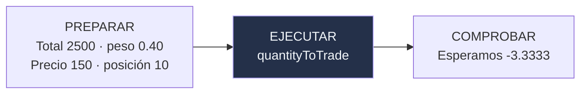

<div class="eyebrow">FRACCIÓN / KATA ZERO</div>

# Introducción a JUnit<br>con Kata Zero

<p class="lead">Del menú de consola a una primera prueba.<br>Una suposición que dejó de cumplirse.</p>

<div class="cover-meta">
<span class="chip">Java 25 · Zulu</span>
<span class="chip">JUnit 6.1.3</span>
<span class="chip">Maven</span>
<span class="chip">Un video · ≈15 minutos</span>
</div>

<!--
Entrada: presentar un ejercicio ficticio, sin conocimientos previos de inversión.
Transición: la meta es comprobar una regla sin navegar por un menú cada vez.
-->

---

<div class="eyebrow">UNA PREGUNTA, TRES MOMENTOS</div>

# ¿Cómo sabemos que el cambio funcionó?

<div class="route" v-click><b>01</b><div>Comprobar a mano<div class="small">Un programa pequeño que parece funcionar.</div></div></div>
<div class="route" v-click><b>02</b><div>Extraer un cálculo<div class="small">Separarlo de teclado y pantalla, sin corregirlo todavía.</div></div></div>
<div class="route" v-click><b>03</b><div>Escribir una prueba<div class="small">Verla fallar, corregir el defecto y ejecutarla de nuevo.</div></div></div>

<p class="caption">Usamos la Kata Zero vigente: dos instrumentos, objetivo 40/60 y cantidades a cuatro decimales.</p>

<!--
Clics 1–3: presentar el recorrido antes de hablar de anotaciones.
Transición: explicar el problema con datos que podemos calcular a mano.
-->

---

<div class="eyebrow">0:00–2:00 / EL PROBLEMA</div>

# Una cuenta. Dos acciones. Un objetivo.

<div class="split equal">
<div>
<p class="lead">Tenemos <strong>10 META</strong> y <strong>10 AAPL</strong>.</p>
<v-clicks>

- Ambos precios iniciales: **100 USD**.
- Buscamos **40% del valor** en META y **60%** en AAPL.
- Proponemos operaciones; no las ejecutamos.

</v-clicks>
</div>
<div class="card purple"><div class="label">EL REQUISITO NUEVO</div><h2>Ahora permitimos fracciones</h2><p>El programa comenzó suponiendo acciones completas. ¿Quedó alguna parte de esa suposición?</p></div>
</div>
<p class="caption">Cuenta y precios ficticios en USD. Sin efectivo, comisiones, impuestos ni cotizaciones reales.</p>

<!--
Clics: precio, distribución y alcance. Explicar que 40/60 se aplica a valor monetario, no al número de acciones.
Transición: resolver el ejemplo entero antes de mirar el código.
-->

---

<div class="eyebrow">EL EJEMPLO HABITUAL</div>

# Si todo da entero, el defecto pasa desapercibido

| Concepto | META | AAPL |
|---|---:|---:|
| Valor actual | 1000 USD | 1000 USD |
| Valor objetivo, sobre 2000 USD | 800 USD | 1200 USD |
| Cantidad objetivo | 8 | 12 |
| Cambio desde 10 acciones | **Vender 2** | **Comprar 2** |

<div class="formula" style="margin-top:26px" v-click>Lo esperado ya está calculado. Ahora podemos comparar.</div>

<!--
Recorrer una columna y luego la otra. Revelar la idea de esperado independiente del programa.
Transición: ejecutar el menú como en un ejercicio de consola familiar.
-->

---

<div class="eyebrow">2:00–4:00 / EL PROGRAMA DE CONSOLA</div>

# Todo cabe en main. También se mezcla todo.

<div class="split">
<div class="terminal">
<span class="prompt">Cuenta de Alex</span><br>
1. Ver cuenta<br>
2. Calcular rebalanceo<br>
0. Salir<br><br>
<span class="small">BufferedReader → opción → println</span>
</div>
<div class="stack">
<div class="card" v-click><h3>52 líneas, un método</h3><p>Lectura, arreglos, cálculo e impresión.</p></div>
<div class="card" v-click><h3>Datos fijos</h3><p>Solo consultamos, calculamos y salimos.</p></div>
<div class="card purple" v-click><h3>Verificación manual</h3><p>Elegimos opciones y revisamos números.</p></div>
</div>
</div>

<!--
Abrir before/Main.java en el IDE. El desorden es deliberado y pequeño; no ridiculizar esta forma familiar de empezar.
Transición: ejecutar 1,2,1,0 y contrastar con la tabla.
-->

---

<div class="eyebrow">PARECE FUNCIONAR</div>

# Vendemos dos. Compramos dos.

<div class="split equal">
<div class="terminal">
<span class="prompt">Plan sugerido</span><br>
VENDER META 2.0000 acciones<br>
COMPRAR AAPL 2.0000 acciones
</div>
<div class="stack">
<div class="card success"><h3>Coincide con nuestro ejemplo</h3><p>La revisión visual da confianza.</p></div>
<div class="card" v-click><h3>El plan no modifica la cuenta</h3><p>La opción 1 sigue mostrando diez acciones de cada una.</p></div>
<div class="card warning" v-click><h3>¿Y otro precio?</h3><p>Un caso que funciona no demuestra todos los demás.</p></div>
</div>
</div>

<!--
Ejecutar desde before: mostrar opciones1,2,1. El texto de consola está recortado a lo relevante.
Transición: cambiar un único dato del escenario.
-->

---
transition: fade
---

<div class="eyebrow">4:00–6:00 / CAMBIA UN DATO</div>

# META ahora cuesta 150 USD

<div class="split equal">
<div class="card"><div class="label">META</div><div class="metric">150<span class="unit"> USD</span></div><p>Seguimos teniendo diez acciones.</p></div>
<div class="card purple"><div class="label">AAPL</div><div class="metric">100<span class="unit"> USD</span></div><p>Seguimos teniendo diez acciones.</p></div>
</div>
<div class="formula" style="margin-top:28px" v-click>Valor total: 10 × 150 + 10 × 100 = 2500 USD</div>
<p class="caption">Para reproducir en consola: cambiar solo el primer precio de 100.00 a 150.00 en una copia y recompilar. El menú no edita precios.</p>

<!--
No cambiar ambos precios. Revelar el total y pedir que se verifique a mano.
Transición: proporcionar el cálculo esperado; no exigir que el estudiante descubra el número sin apoyo.
-->

---

<div class="eyebrow">EL RESULTADO QUE DEBERÍAMOS OBTENER</div>

# META debe representar 1000 USD

<div class="trio">
<div class="card" v-click><div class="label">VALOR OBJETIVO</div><h2>2500 × 0.40</h2><p>1000 USD en META.</p></div>
<div class="card purple" v-click><div class="label">CANTIDAD OBJETIVO</div><h2>1000 ÷ 150</h2><p>6.666666… acciones.</p></div>
<div class="card success" v-click><div class="label">CUÁNTO VENDER</div><h2>10 − 6.666666…</h2><p><strong>3.3333 acciones</strong> a cuatro decimales.</p></div>
</div>
<p class="lead" style="margin-top:30px">El esperado sale del requisito y de esta cuenta, <strong>no del programa</strong>.</p>

<!--
Tres clics y una operación por tarjeta. Recordar que una orden negativa indica venta.
Transición: ejecutar el escenario nuevo y comparar sin señalar aún la línea culpable.
-->

---

<div class="eyebrow">EL EJEMPLO NUEVO REVELA UN PROBLEMA</div>

# El programa propone vender cuatro

<div class="split equal">
<div class="terminal">
<span class="prompt">Plan sugerido</span><br>
<span class="fail">VENDER META 4.0000 acciones</span><br>
COMPRAR AAPL 5.0000 acciones
</div>
<div class="stack">
<div class="card warning"><h3>Esperábamos 3.3333</h3><p>Una diferencia visible: se propone vender aproximadamente 100 USD de más.</p></div>
<div class="card" v-click><h3>Necesitamos repetir esta pregunta</h3><p>¿Cuánto debe vender con este precio y este objetivo?</p></div>
</div>
</div>

<!--
Dar tiempo para leer. Separar este error grande del residuo diminuto que puede producir un redondeo final normal.
Transición: extraer el cálculo para poder preguntar sin teclado y sin inspeccionar una pantalla completa.
-->

---

<div class="eyebrow">6:00–8:00 / EXTRAER SIN CORREGIR</div>

# Una entrada controlada. Una salida que podemos revisar.

<div class="split code-compact">
<div>

```java {1-3|4-7|*}{lines:true}
static BigDecimal quantityToTrade(BigDecimal totalValue,
    BigDecimal targetWeight, BigDecimal price,
    BigDecimal currentQuantity) {
  int target = totalValue.multiply(targetWeight)
      .divide(price, 4, RoundingMode.HALF_EVEN).intValue();
  return BigDecimal.valueOf(target)
      .subtract(currentQuantity).setScale(4);
}
```

</div>
<div class="stack">
<div class="card"><h3>Cuatro datos</h3><p>Total, proporción, precio y cantidad actual.</p></div>
<div class="card purple" v-click><h3>Una cantidad con signo</h3><p>Negativa: vender. Positiva: comprar.</p></div>
<div class="card warning" v-click><h3>El defecto sigue ahí</h3><p>Extraer un método no corrige su comportamiento.</p></div>
</div>
</div>

<!--
Mostrar after/01: el método tiene las mismas operaciones de before, solo cambia el sitio. En la diapositiva se ajustan saltos de línea para legibilidad.
Transición: introducir JUnit como herramienta para expresar y ejecutar la comprobación.
-->

---

<div class="eyebrow">UNA HERRAMIENTA PARA REPETIR LA COMPROBACIÓN</div>

# JUnit conecta nuestra prueba con el ejecutor

<div class="diagram">



</div>
<div class="split equal" style="margin-top:26px">
<div class="card"><h3>Escribimos con Jupiter</h3><p>JUnit 6.1.3 se agrega con alcance test.</p></div>
<div class="card purple" v-click><h3>Usamos el mismo entorno</h3><p>SDKMAN 25.0.5.0+8-zulu y Maven Wrapper.</p></div>
</div>

<!--
Diagrama mínimo: no explicar extensiones ni motores de migración en esta introducción. Mostrar src/test/java y dependencia test en el IDE.
Transición: organizar la prueba como tres pasos reconocibles.
-->

---

<div class="eyebrow">8:00–11:00 / EL PATRÓN AAA</div>

# Preparar → Ejecutar → Comprobar

<div class="diagram">



</div>
<div class="trio" style="margin-top:28px">
<div class="card" v-click><h3>Arrange</h3><p>Entradas conocidas.</p></div>
<div class="card" v-click><h3>Act</h3><p>Una llamada al cálculo.</p></div>
<div class="card" v-click><h3>Assert</h3><p>Un esperado calculado a mano.</p></div>
</div>

<!--
Tres clics: términos en inglés que aparecerán en documentación y su equivalente en español. El signo menos expresa venta.
Transición: llevar esos mismos datos a la primera prueba del repositorio.
-->

---

<div class="eyebrow">LA PRIMERA PRUEBA · FRAGMENTO DEL ARCHIVO DEL CURSO</div>

# Una pregunta concreta para el cálculo

<div class="code-compact">

```java {1-3|4-5|7-9|11-12|*}{lines:true}
@Test
@DisplayName("Con META a 150 USD, propone vender 3.3333 acciones")
void preservesFractionalSharesWhenPriceChanges() {
    // Preparar: 10 META a 150 USD + 10 AAPL a 100 USD = 2500 USD.
    BigDecimal totalValue = new BigDecimal("2500.00");

    // Ejecutar: META debe representar 40% de la cuenta.
    BigDecimal order = RebalanceCalculator.quantityToTrade(totalValue,
            new BigDecimal("0.40"), new BigDecimal("150.00"), new BigDecimal("10"));

    // Comprobar: 1000 / 150 - 10 = -3.333333...; cuatro decimales.
    assertEquals(new BigDecimal("-3.3333"), order);
}
```

</div>
<p class="caption">Imports y clase contenedora en RebalanceCalculatorTest.java. assertEquals recibe primero lo esperado y después lo obtenido.</p>

<!--
Focos: @Test/nombre, preparar, ejecutar, comprobar y vista completa. @DisplayName hace legible el propósito en español.
Transición: ejecutar con el calculador heredado para ver una falla útil.
-->

---

<div class="eyebrow">ROJO / UNA EXPECTATIVA NO SE CUMPLIÓ</div>

# La prueba repite lo que revisábamos a mano

<div class="split equal">
<div class="terminal">
<span class="fail">AssertionFailedError</span><br>
expected: &lt;-3.3333&gt;<br>
but was: &lt;-4.0000&gt;<br><br>
<span class="small">preservesFractionalSharesWhenPriceChanges</span>
</div>
<div class="stack">
<div class="card" v-click><h3>Esperado</h3><p>La venta de 3.3333 que calculamos antes.</p></div>
<div class="card warning" v-click><h3>Obtenido</h3><p>El programa sigue proponiendo vender cuatro.</p></div>
<div class="card" v-click><h3>Ahora es repetible</h3><p>No necesitamos navegar por el menú.</p></div>
</div>
</div>
<p class="caption">Estado reproducible: etiqueta Git kata-zero-v3-first-test-red.</p>

<!--
Leer expected y actual antes de los clics. No cambiar el esperado para que la barra se vuelva verde.
Transición: localizar la suposición heredada: la conversión a entero.
-->

---

<div class="eyebrow">11:00–13:00 / LA SUPOSICIÓN HEREDADA</div>

# El int descarta la parte fraccionaria

<div class="split equal">
<div class="card warning"><div class="label">LO QUE SE CALCULÓ</div><div class="metric">6.6667</div><p>Cantidad objetivo aproximada.</p></div>
<div class="card" v-click><div class="label">DESPUÉS DE INTVALUE()</div><div class="metric">6</div><p>Se propone vender 10 − 6 = 4.</p></div>
</div>
<div class="formula" style="margin-top:28px" v-click>Permitir fracciones exige conservarlas durante el cálculo.</div>
<p class="caption">Añadir ceros para imprimir 4.0000 no recupera la fracción descartada.</p>

<!--
Primer clic: mostrar el truncamiento. Segundo: conectar el tipo de dato con el requisito nuevo.
Transición: corregir el calculador manteniendo intacta la prueba.
-->

---

<div class="eyebrow">CORREGIR EL CÁLCULO · LA PRUEBA NO CAMBIA</div>

# Conservar decimales y redondear la orden final

<div class="code-compact">

````md magic-move {duration:650, lines:true}
```java
static BigDecimal quantityToTrade(BigDecimal totalValue, BigDecimal targetWeight,
                                  BigDecimal price, BigDecimal currentQuantity) {
    int target = totalValue.multiply(targetWeight)
            .divide(price, 4, RoundingMode.HALF_EVEN).intValue();
    return BigDecimal.valueOf(target).subtract(currentQuantity).setScale(4);
}
```
```java
static BigDecimal quantityToTrade(BigDecimal totalValue, BigDecimal targetWeight,
                                  BigDecimal price, BigDecimal currentQuantity) {
    return totalValue.multiply(targetWeight)
            .subtract(currentQuantity.multiply(price))
            .divide(price, 4, RoundingMode.HALF_EVEN);
}
```
````

</div>
<div class="card success" style="margin-top:28px"><h3>Objetivo monetario − valor actual, dividido entre precio</h3><p>1000 − 1500 = −500 USD; −500 ÷ 150 = −3.333333… acciones.</p></div>

<!--
Un clic transforma el código heredado en el corregido del repositorio. La resta antes de dividir permite redondear una sola vez la orden.
Transición: ejecutar la misma prueba y comprobar el nuevo resultado.
-->

---

<div class="eyebrow">VERDE / EJECUTAR DE NUEVO</div>

# La misma pregunta. El resultado correcto.

<div class="terminal">
<span class="prompt">./mvnw -f kata-zero/after/02-first-test/pom.xml test</span><br><br>
Tests run: 1 · Failures: 0 · Errors: 0 · Skipped: 0<br>
<span class="prompt">BUILD SUCCESS</span>
</div>
<div class="split equal" style="margin-top:28px">
<div class="card success" v-click><h3>Venta propuesta: 3.3333 META</h3><p>Quedan 6.6667 acciones a la precisión elegida.</p></div>
<div class="card purple" v-click><h3>El ejemplo inicial sigue funcionando</h3><p>Con ambos precios a 100 USD: vender dos y comprar dos.</p></div>
</div>

<!--
Mostrar el resultado real de Maven en la grabación. En Windows nativo usar mvnw.cmd; terminal e IDE deben usar el mismo Zulu.
Transición: explicar lo que esta prueba demuestra y lo que aún no cubre.
-->

---

<div class="eyebrow">13:00–15:00 / QUÉ GANAMOS</div>

# Una regla protegida. No todo el programa demostrado.

<div class="trio">
<div class="card" v-click><div class="label">YA PODEMOS</div><h3>Repetir una comprobación</h3><p>Con entradas y esperado conocidos.</p></div>
<div class="card warning" v-click><div class="label">TODAVÍA FALTA</div><h3>Otros escenarios</h3><p>Total de cuenta, consola y más casos de cálculo.</p></div>
<div class="card purple" v-click><div class="label">ESTE RECORRIDO</div><h3>Prueba de regresión</h3><p>El programa existía antes de la prueba. No lo presentamos como TDD.</p></div>
</div>
<p class="lead" style="margin-top:30px">Lo importante: <strong>una falla nos ayuda a comprobar un cambio</strong>.</p>

<!--
Tres clics para evitar vender una prueba como garantía universal. No introducir más anotaciones ni técnicas aquí.
Transición: cerrar con una segunda pregunta del mismo escenario como práctica opcional.
-->

---
class: chapter
transition: fade
---

<div class="eyebrow">PRUÉBALO TÚ / OPCIONAL</div>

# ¿Cuánto debemos<br>comprar de AAPL?

<p class="lead">Con el precio nuevo, AAPL debe representar 1500 USD.<br>A 100 USD por acción necesita 15; ya tenemos 10.</p>

<div class="card success" style="margin-top:25px;max-width:900px" v-click><h3>Esperado: comprar 5.0000 acciones</h3><p>Agrega otra prueba con @Test y assertEquals. Sin entrega ni calificación.</p></div>

<!--
Revelar el esperado después de una pausa breve. El reto practica expresar una regla; no requiere descubrir matemáticas ocultas.
Salida: cerrar el video. La próxima lección puede profundizar en la estructura y ejecución de pruebas Jupiter.
-->
