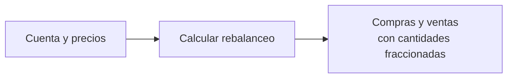

# Introducción a JUnit

<!--
Entrada: presentar la historia de un cambio pequeño que dejó un defecto. Cuenta y precios son ficticios.
Transición: primero mostrar el programa antes del requisito nuevo, sin explicar todavía JUnit.
-->

---

# ¿Qué hace Panther Broker?

<p class="lead">Tenemos una cuenta con acciones, sus cantidades y precios. La persona elige cómo quiere distribuir el valor de su portafolio.</p>

<div class="split equal" style="margin-top:30px">
<div class="card"><h3>Entrada</h3><p>Acciones y precios de la cuenta, más un porcentaje objetivo para cada acción.</p><p><code>int[] prices = {100, 100};</code></p></div>
<div class="card success" v-click><h3>Resultado</h3><p>Un plan que propone cuánto comprar o vender para acercarse a esa distribución.</p></div>
</div>
<p class="small" style="margin-top:26px" v-click>Es una propuesta: el programa no ejecuta operaciones.</p>

<!--
Entrada: presentar brevemente el problema con una cuenta ficticia. El usuario introduce los objetivos, y los precios y cantidades forman los datos de la cuenta.
Clic: mostrar que el resultado es un plan de compras y ventas. Siguiente clic: aclarar que el programa no ejecuta órdenes.
Transición: ver un fragmento del código original que construye esa propuesta.
-->

---

# El código original de Panther Broker

<div class="split code-original">
<div>

```java {1-4|5-8|9-17|*}{lines:true}
String[] symbols = {"META", "AAPL"};
int[] prices = {100, 100};
int[] quantities = {10, 10};
int[] percentages = new int[symbols.length];
int total = 0;
for (int i = 0; i < symbols.length; i++) {
    total += prices[i] * quantities[i];
}
for (int i = 0; i < symbols.length; i++) {
    int targetValue = total * percentages[i] / 100;
    int targetShares = targetValue / prices[i];
    int difference = targetShares - quantities[i];
    if (difference != 0) {
        System.out.println((difference < 0 ? "VENDER " : "COMPRAR ")
                + symbols[i] + " " + Math.abs(difference) + " acciones");
    }
}
```

<p class="caption">Datos y cálculo de before/Main.java. Omitimos imports, menú y lectura de objetivos; todo estaba dentro de main.</p>
</div>
<div class="stack">
<div class="card"><h3>Su propósito</h3><p>Proponer qué vender y comprar según los porcentajes elegidos por la persona.</p></div>
<div class="card purple" v-click><h3>Cómo lo hacía</h3><p>Calculaba el valor total, las cantidades objetivo y la diferencia frente a las acciones disponibles.</p></div>
<div class="card" v-click><h3>Qué entregaba</h3><p>Un plan por consola con acciones completas. No ejecutaba operaciones.</p></div>
</div>
</div>

<!--
Entrada: presentar el programa de Panther Broker antes de mostrar el ejemplo. La consulta y el menú permanecen en el archivo original.
Focos: datos, valor total y cálculo de las órdenes. Las tarjetas explican el propósito, sin adelantar el requisito de fracciones ni el defecto.
Transición: usar estos datos para comprobar a mano el primer plan.
-->

---

# Al principio, solo manejábamos acciones completas

<div class="split equal">
<div>
<p class="lead">10 META y 10 AAPL.<br>Ambas a <strong>100 USD</strong>.<br>Ingresamos como objetivo: <strong>40% / 60% del valor</strong>.</p>
<div class="card" style="margin-top:24px"><h3>El menú propone operaciones</h3><p>Ver cuenta · Ingresar objetivos · Calcular rebalanceo · Salir.</p></div>
</div>
<div class="receipt">
<div class="receipt-row"><span>Objetivo META</span><b>800 USD → 8 acciones</b></div>
<div class="receipt-row"><span>Objetivo AAPL</span><b>1200 USD → 12 acciones</b></div>
<div class="receipt-row total"><span>Plan</span><b>Vender 2 META</b></div>
<div class="receipt-row"><span></span><b>Comprar 2 AAPL</b></div>
</div>
</div>

<!--
Entrada: explicar rebalancear como ajustar el valor repartido entre instrumentos. No enseñar teoría financiera.
Transición: el programa funciona para este caso de acciones completas, pero el requisito cambia.
-->

---
transition: fade
---

# Ahora también queremos comprar y vender fracciones

<p class="lead">La cantidad ya no tiene que ser 2, 5 o 10.<br>También puede ser <strong>3.333333 acciones</strong>.</p>

<div class="diagram" style="margin-top:30px">



</div>
<div class="card purple" style="margin-top:26px" v-click><h3>«Entonces cambio int por double»</h3><p>Una adaptación que parece pequeña. ¿Será suficiente?</p></div>

<!--
Entrada: introducir el requisito sin hablar de precisión financiera avanzada.
Clic: representar el razonamiento de quien adapta el programa. Transición: mostrar exactamente ese cambio.
-->

---

# Cambiamos el tipo de la cantidad

<div class="split code-compact">
<div>

````md magic-move {duration:600, lines:true}
```java
int targetValue = totalValue * targetPercent / 100;
int targetShares = targetValue / price;
int difference = targetShares - currentQuantity;
```
```java
int targetValue = totalValue * targetPercent / 100;
double targetShares = targetValue / price;
double difference = targetShares - currentQuantity;
```
````

</div>
<div class="stack">
<div class="card"><h3>Antes</h3><p>Cantidades completas en variables int.</p></div>
<div class="card purple"><h3>Después</h3><p>Las variables que guardan cantidades ahora aceptan decimales.</p></div>
</div>
</div>
<p class="caption">Fragmento del cálculo: por ahora conservamos los importes y precios enteros del ejemplo.</p>

<!--
Entrada: un clic transforma int en double. No señalar todavía el tipo de los operandos de la división.
Transición: hacemos lo habitual: volver a ejecutar con los mismos datos y comparar a mano.
-->

---

# El ejemplo de siempre sigue funcionando

<TerminalRecording name="manual-original" alt="Grabación real de la consola con el ejemplo habitual: vender dos META y comprar dos AAPL" />

<div class="split equal" style="margin-top:22px">
<div class="card success"><h3>Vender 2 · Comprar 2</h3><p>Coincide con lo que ya esperábamos.</p></div>
<div class="card" v-click><h3>«Listo, ya acepta fracciones»</h3><p>Pero todavía no probamos un resultado fraccionario.</p></div>
</div>

<!--
Entrada: reproducir la grabación completa del programa adaptado: comando, menú, cuenta, objetivos 40 y 60, cálculo y salida. No simular una terminal con texto inventado.
Clic: mostrar el salto de confianza. Transición: cambiar un precio, manteniendo la misma cuenta.
-->

---

# Solo cambia META: de 100 a 150 USD

<div class="trio">
<div class="card" v-click><div class="label">TOTAL DE LA CUENTA</div><h2>2500 USD</h2><p>10 × 150 + 10 × 100.</p></div>
<div class="card purple" v-click><div class="label">OBJETIVO META · 40%</div><h2>1000 USD</h2><p>1000 ÷ 150 = 6.666666… acciones.</p></div>
<div class="card success" v-click><div class="label">VENTA ESPERADA</div><h2>3.333333</h2><p>Tenemos 10; necesitamos conservar 6.666666…</p></div>
</div>
<p class="lead" style="margin-top:30px">Ese es el resultado esperado. <strong>Lo calculamos antes de ejecutar.</strong></p>

<!--
Entrada: una operación por clic y tiempo para seguirla. Se proporciona el esperado, no se pide resolver un acertijo.
Transición: ejecutar el programa adaptado con estos datos nuevos.
-->

---

# Esperábamos vender 3.333333. Propone vender 4.

<TerminalRecording name="manual-fractional" alt="Grabación real del programa adaptado con META a150USD: propone vender cuatro acciones" />

<div class="card warning" style="margin-top:24px" v-click><h3>El programa ejecuta, pero no cumple el requisito nuevo</h3><p>Ahora tenemos que volver a revisar y repetir la comparación cada vez que cambiemos el código.</p></div>

<!--
Entrada: comparar explícitamente el esperado con la salida real. No llamar redondeo correcto a la pérdida de la fracción.
Transición: reconocer que ese caso podía haberse comprobado al cambiar el requisito, antes de dar la adaptación por terminada.
-->

---

# Pudimos y debimos detectar el error antes

<v-clicks>

- No podemos comprobar **todos los casos a mano** después de cada cambio.
- Una función nueva puede introducir errores o **romper lo que ya funcionaba**.
- Necesitamos guardar las comprobaciones **en código** y ejecutarlas automáticamente.
- Con datos y condiciones controladas, podemos repetirlas y obtener **el mismo resultado**.

</v-clicks>

<!--
Entrada: conectar con el caso fraccionario que faltó comprobar al adaptar el programa. No responsabilizar a quien aprende de anticipar todos los errores posibles.
Clics: explicar el límite de la revisión manual, el riesgo de regresión y la necesidad de comprobaciones programables y deterministas. Las pruebas requieren casos adecuados y condiciones controladas.
Transición: dar nombre a esta herramienta: pruebas unitarias.
-->

---

# Presentamos las pruebas unitarias

<p class="lead">Una comprobación automática de un comportamiento concreto de una pequeña parte del programa, como un método.</p>

<div class="trio" style="margin-top:30px">
<div class="card" v-click><h3>Datos conocidos</h3><p>Una cuenta, un precio y un porcentaje objetivo.</p></div>
<div class="card purple" v-click><h3>Una operación</h3><p>Calcular cuántas acciones comprar o vender.</p></div>
<div class="card success" v-click><h3>Un resultado esperado</h3><p>Comparar lo obtenido con lo que debería pasar.</p></div>
</div>

<p class="small" style="margin-top:26px" v-click>JUnit nos ayuda a escribir y ejecutar esas pruebas en Java.</p>

<!--
Entrada: dar nombre a la comparación que acabamos de hacer a mano: una prueba unitaria la convierte en una comprobación automática de una parte pequeña del código.
Clics: conectar datos, operación y resultado esperado con el cálculo de Panther Broker. Después, revelar la frase que presenta a JUnit. No introducir todavía anotaciones ni la estructura completa de una prueba.
Transición: guardar primero las expectativas del ejemplo habitual y ejecutarlas con JUnit.
-->

---

# Las pruebas que pudimos tener desde la versión int

<div class="code-compact">

```java {1-6|8-13|*}{lines:true}
@Test
void sellsTwoSharesWhenAboveTarget() {
    assertEquals(-2.0,
        RebalanceCalculator.quantityToTrade(2000, 40, 100, 10),
        0.000001);
}

@Test
void buysTwoSharesWhenBelowTarget() {
    assertEquals(2.0,
        RebalanceCalculator.quantityToTrade(2000, 60, 100, 10),
        0.000001);
}
```

</div>
<p class="caption">Casos del requisito original, escritos sobre el cálculo extraído del main: vender 2 META y comprar 2 AAPL.</p>

<!--
Entrada: volver al contrato de acciones completas. Estas dos expectativas podían haberse guardado desde la primera versión; no afirmar que el main original ya tenía pruebas.
Clics: mostrar la venta esperada y después la compra esperada. Los ejemplos corresponden a OriginalExamplesTest; se omiten imports y DisplayName y se distribuyen las llamadas en varias líneas.
El cálculo se extrae del main para poder llamarlo directamente. Usamos la firma actual compatible con la evolución fraccionaria; el detalle de la extracción y la tolerancia se explicará durante el curso.
Transición: ejecutar esos casos después del cambio a double para comprobar que el comportamiento anterior se conserva.
-->

---

# El cambio a double conserva los casos originales

<p class="small">Reutilizamos las expectativas de la versión entera después de agregar fracciones.</p>
<TerminalRecording name="tests-original-green" alt="Grabación real de JUnit: las dos pruebas del ejemplo habitual pasan aunque el defecto sigue presente" compact />
<div class="card warning" style="margin-top:22px" v-click><h3>Dos pruebas verdes todavía pueden omitir el defecto</h3><p>Repetir automáticamente el mismo caso entero no comprueba que funcionen las fracciones.</p></div>

<!--
Entrada: reproducir Maven y mostrar el resultado real de dos pruebas. Explicar que una suite necesita ejemplos adecuados: JUnit no descubre requisitos por sí solo.
Clic: hacer explícito por qué verde no equivale a corrección universal. Transición: agregar el caso que faltaba.
-->

---

# El requisito fraccionario necesita una prueba nueva

<div class="code-compact">

```java {1|3|4|*}{lines:true}
@Test
void preservesFractionalSharesWhenSelling() {
    double order = RebalanceCalculator.quantityToTrade(2500, 40, 150, 10);
    assertEquals(-3.333333, order, 0.000001);
}
```

</div>
<TerminalRecording v-click="4" :reveal-at="4" name="tests-fractional-red" alt="Grabación real de la suite con el nuevo caso fraccionario: se esperaba aproximadamente menos3.333333 y se obtuvo menos4" short />
<p class="caption">Primero lo esperado; después lo obtenido. La tolerancia permite comparar este resultado aproximado.</p>

<!--
Entrada: los focos señalan la llamada con datos nuevos y luego el esperado con tolerancia. No enseñar todavía toda la API de assertions.
Reproducir la grabación de Maven: las pruebas anteriores pasan y la nueva revela el defecto. Transición: explicar qué quedó del supuesto de enteros.
-->

---

# Guardar en double no cambia una división entre int

<div class="split code-compact">
<div>

````md magic-move {duration:650, lines:true}
```java
int targetValue = totalValue * targetPercent / 100;
double targetShares = targetValue / price;
return targetShares - currentQuantity;
```
```java
int targetValue = totalValue * targetPercent / 100;
double targetShares = targetValue / (double) price;
return targetShares - currentQuantity;
```
````

</div>
<div class="stack">
<div class="card warning"><h3>1000 / 150</h3><p>Ambos operandos son int: primero se obtiene 6; después se guarda 6.0.</p></div>
<div class="card success"><h3>1000 / 150.0</h3><p>La división conserva una aproximación de la parte fraccionaria.</p></div>
</div>
</div>
<p class="caption">Usamos un ejemplo numérico pequeño para introducir pruebas. La representación decimal del dinero se abordará después.</p>

<!--
Entrada: explicar el orden: primero se calcula la expresión, después se asigna. Un clic transforma solo la división.
Corregimos el cálculo, sin cambiar lo que espera la prueba. Transición: volver a ejecutar toda la suite, no solo el caso nuevo.
-->

---

# Corregimos el cálculo. Todas las pruebas pasan.

<TerminalRecording name="tests-fixed-green" alt="Grabación real de Maven y JUnit después de corregir: las tres pruebas pasan" />

<div class="split equal" style="margin-top:22px">
<div class="card success"><h3>Una comprobación reutilizable</h3><p>Ahora el caso fraccionario forma parte de nuestra red de pruebas.</p></div>
<div class="card" v-click><h3>Detectarlo antes</h3><p>Incluir ese caso al adaptar el programa habría señalado el defecto antes de dar el cambio por terminado.</p></div>
</div>

<!--
Entrada: reproducir Maven de principio a fin y mostrar las tres pruebas verdes. No afirmar que la suite valida todos los posibles resultados.
Clic: conectar el beneficio con la historia inicial. Transición: anunciar lo que se aprenderá durante el curso.
-->

---
class: chapter
transition: fade
---

# Pruebas que explican.<br>Cambios con confianza.

<div style="margin-top:22px">
<span class="chip" v-click>JUnit y componentes de una prueba</span>
<span class="chip" v-click>AAA, ciclo de vida y excepciones</span>
<span class="chip" v-click>Pruebas parametrizadas</span>
<span class="chip" v-click>Mockito y aislamiento</span>
<span class="chip" v-click>TDD y refactorización</span>
<span class="chip" v-click>Tiempo, precisión y cobertura</span>
</div>
<p class="lead" style="margin-top:26px">Seguiremos con ejemplos del simulador Panther Broker.<br>Videos y práctica opcional, sin actividades calificadas.</p>

<!--
Entrada: anunciar los temas del curso sin explicar sus técnicas todavía. Los nombres son una ruta, no prerrequisitos.
Salida: esta introducción motiva el curso; los detalles y la metodología se trabajan en las siguientes lecciones.
-->
